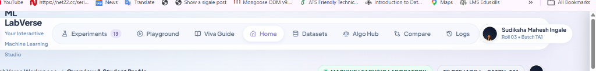
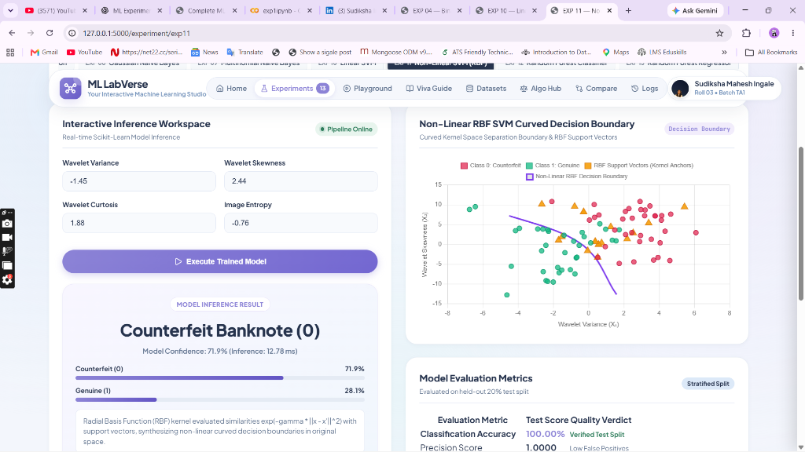
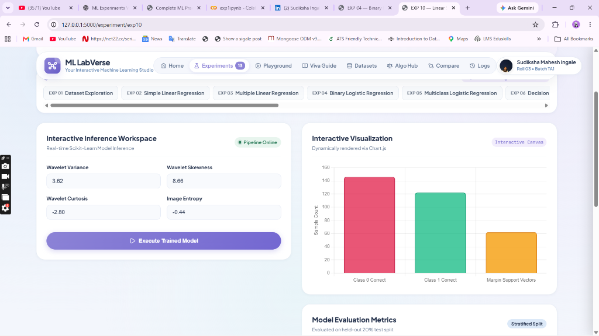

# ML LabVerse — Interactive Machine Learning Studio & Laboratory Workspace

<p align="center">
  
</p>

<p align="center">
  <a href="https://github.com/Sudiksha29/ML_ALL_Experiments"></a>
  <a href="https://www.linkedin.com/in/sudiksha-ingale-3bb37232b"></a>
  
  
  
  
  
</p>

> **ML LabVerse** is an interactive, academic Machine Learning laboratory platform uniting all **13 curriculum practicals** into a unified web application. Featuring **live Scikit-Learn inference**, **interactive 2D Decision Boundary plots with real-time test point injection**, **dedicated Parameter Workspaces**, **Algorithm Comparison Hub**, and **Comprehensive Viva Voce Examination Defense Guides**.

---

## 📸 Actual Project Screenshots

### 1. Non-Linear RBF SVM Curved Decision Boundary & Live Prediction
> Live demonstration of **EXP 11 (Non-Linear SVM)** showcasing the **RBF Kernel Curved Boundary ($\text{decision\_function} = 0$)**, kernel support vectors, and real-time input feature point plotting on the contour.

<p align="center">
  
</p>

### 2. Interactive Experiment Parameter Workspace & 13-Algorithm Switcher Dock
> Direct parameter configuration lab with instant Scikit-learn inference, confidence breakdowns, evaluated prediction feature chips, and quick-switching dock.

<p align="center">
  
</p>

---

## 🎓 Academic Credentials

- **Developer:** Sudiksha Mahesh Ingale
- **Roll Number:** 03 | **Batch:** TA1
- **College:** D. Y. Patil College of Engineering and Technology, Kolhapur
- **Department:** Computer Science and Engineering — Artificial Intelligence & Machine Learning
- **Faculty Guide:** Dr. Sachin Takmare
- **Course:** Machine Learning Laboratory (Semester VI)
- **Academic Year:** 2025–2026
- **GitHub Repository:** [https://github.com/Sudiksha29/ML_ALL_Experiments](https://github.com/Sudiksha29/ML_ALL_Experiments)
- **LinkedIn Profile:** [https://www.linkedin.com/in/sudiksha-ingale-3bb37232b](https://www.linkedin.com/in/sudiksha-ingale-3bb37232b)

---

## 🌟 Key Highlights

1. **All 13 Machine Learning Practicals Covered:**
   - 1 Exploratory Data Analysis studio + 12 predictive ML algorithms across Regression, Classification, NLP, and Ensemble Learning.
2. **Visual Decision Boundaries for Both SVMs:**
   - **Linear SVM (EXP 10):** Optimal Separating Hyperplane ($w \cdot x + b = 0$), $+1$ and $-1$ margins ($\frac{2}{\|w\|}$), margin support vectors, and real-time test point injection.
   - **Non-Linear RBF SVM (EXP 11):** Exact non-linear curved decision boundary ($K(x, x') = \exp(-\gamma \|x - x'\|^2)$) mapped using Brent's numerical root-finding algorithm.
3. **Real-Time Prediction & Evaluated Feature Echo:**
   - Sub-15ms live inference executing actual cached Scikit-learn pipelines with class probability distributions and plain-English decision explanations.
   - Dedicated **Evaluated Prediction Features** panel echoing all input parameters.
4. **Interactive 13-Algorithm Switcher Bar:**
   - Horizontal dock across all experiment pages with auto-centering on the active practical.
5. **Algorithm Comparison Hub:**
   - Side-by-side comparative analysis of all 12 predictive algorithms by Working Principle, Advantages, Limitations, Best Use Cases, and Decision Criteria.
6. **Viva Voce Defense Center:**
   - Over 50+ faculty examination questions, algorithmic proofs, code explanations, and LaTeX formulas.
7. **Downloadable Formal PDF Reports:**
   - Generates publication-ready academic lab reports via ReportLab with student credentials, dataset statistics, charts, and verification blocks.

---

## 📋 Complete Practical Curriculum Mapping

| Exp # | Experiment Title | Algorithm | Dataset | Input Features | Key Evaluation & Outputs |
|:---:|---|---|---|---|---|
| **01** | Dataset Exploration & Visualization | EDA (Pandas, Seaborn) | Multi-Dataset Suite | Tabular features | Descriptive stats, histograms, correlation matrix |
| **02** | Simple Linear Regression | `LinearRegression` | Placement & Study Hours | `cgpa` / `hours` | $y = mx + c$, Scatter line plot, $R^2$, MSE, MAE |
| **03** | Multiple Linear Regression | `LinearRegression` | CGPA-IQ & Real Estate | Multiple numerical inputs | $\beta_i$ coefficients, intercept, Actual vs. Predicted |
| **04** | Binary Logistic Regression | `LogisticRegression` | Titanic & Placement | Passenger / Academic features | Sigmoid $\sigma(z)$, ROC-AUC curve, Confusion Matrix |
| **05** | Multiclass Logistic Regression | `LogisticRegression(multinomial)` | Student Performance & Iris | Study hours, Attendance / Petal dims | Softmax probabilities, Multiclass Breakdown |
| **06** | Decision Tree Classification | `DecisionTreeClassifier` (Gini) | Heart Disease (UCI) | 13 Clinical biomarkers | Gini impurity, Feature Importances, Decision rules |
| **07** | K-Nearest Neighbors (KNN) | `KNeighborsClassifier` | Diabetes & Breast Cancer | Diagnostic measurements | $K=17$ Euclidean cross-validation curve |
| **08** | Gaussian Naive Bayes | `GaussianNB` | Banknote Authentication | 4 Wavelet continuous features | Gaussian normal curves, Class conditional priors |
| **09** | Multinomial Naive Bayes | `MultinomialNB` + `CountVectorizer` | Campus Messages (56 msgs) | Raw message text | Bag-of-Words, Laplace smoothing, Vocabulary log-odds |
| **10** | Linear Support Vector Machine | `SVC(kernel='linear')` | Banknote Authentication | 4 Continuous wavelet attributes | Hyperplane line, Margins, Support Vector markers |
| **11** | Non-Linear Support Vector Machine | `SVC(kernel='rbf')` | Banknote Authentication | 4 Continuous wavelet attributes | Curved RBF Boundary, Kernel anchors, Live point plot |
| **12** | Random Forest Classification | `RandomForestClassifier` | Diabetes (100 Trees) | 8 Metabolic indicators | Majority voting, Ensemble bagging, Feature importances |
| **13** | Random Forest Regression | `RandomForestRegressor` | Diabetes (Fasting Glucose) | 7 Predictors | Ensemble mean aggregation, Continuous Glucose target |

---

## 📂 Project Architecture

```
ML_Mini_Project/
├── app.py                     # Main Flask Application Entrypoint & Blueprint Dispatcher
├── config.py                  # Project Metadata, Student Information & Experiment Registry
├── requirements.txt           # Python Package Dependencies
├── README.md                  # Project Documentation with Screenshots
├── .gitignore                 # Clean Git Tracking Filter
│
├── assets/
│   └── screenshots/           # Actual UI Screenshots for Documentation
│       ├── home_dashboard.png
│       ├── svm_decision_boundary.png
│       └── experiment_workspace.png
│
├── data/
│   └── raw/                   # 15 Authentic Benchmark Datasets (CSV)
│
├── models/                    # 18 Pre-Trained Scikit-Learn Pipelines (.joblib)
│
├── training/
│   ├── train_all.py           # Master Pipeline with Brent's Root-Finding for Decision Boundaries
│   └── metrics_store.json     # Precomputed Held-Out Test Metrics & Decision Boundary Data
│
├── services/
│   ├── model_registry.py      # In-Memory Estimator Cache & Metrics Loader
│   ├── prediction_service.py  # Real-Time Inference, Confidence & Input Echo Service
│   ├── dataset_service.py     # Exploratory Data Profiler & Summary Statistics Engine
│   ├── report_generator.py    # ReportLab Academic PDF Report Generator
│   ├── algorithm_comparison_data.py # Comparison Hub Knowledge Engine
│   └── history_service.py     # SQLite Prediction Logging Service
│
├── routes/
│   ├── dashboard_routes.py    # Home Dashboard, Profile & About Views
│   ├── experiment_routes.py   # Dedicated Interactive Experiment Execution Workspace
│   ├── prediction_routes.py   # REST APIs for Model Inferences & Presets
│   ├── comparison_routes.py   # Algorithm Comparison Hub & Model Comparator
│   ├── learning_routes.py     # Viva Voce Examination Center & Playground
│   ├── dataset_routes.py      # Dataset Explorer Views & JSON APIs
│   └── report_routes.py       # Downloadable PDF Lab Reports
│
├── templates/                 # Jinja2 HTML5 Responsive Templates
│   ├── base.html              # Modern Floating Navbar with Student Badge & Mobile Drawer
│   ├── dashboard.html         # Curriculum Overview, Stats Counter & Filterable Catalog
│   ├── experiment_detail.html # Parameter Form, Decision Boundary Canvas & Deep Dive Tabs
│   ├── experiment_01_eda.html # Dedicated Interactive EDA Studio
│   ├── algorithm_comparison.html # Theory Hub & Side-by-Side Algorithm Comparator
│   ├── learning_center.html   # Complete 50+ Viva Q&A Examination Guide
│   ├── model_playground.html  # Interactive Sandbox
│   └── profile.html           # Full Academic Student Profile
│
├── static/
│   ├── css/
│   │   ├── style.css          # Soft Academic Futurism Theme
│   │   ├── components.css     # Cards, Switchers, Badges, Tables
│   │   └── animations.css     # Micro-Interactions & Pulsing Badges
│   └── js/
│       ├── charts.js          # Chart.js Renderers (Linear & RBF Decision Boundaries)
│       ├── predictions.js     # AJAX Form Submissions, Evaluated Feature Tags & Events
│       └── main.js            # Live Search & Filter Dock Controls
│
└── tests/
    └── test_endpoints.py      # Automated 20-Point Unit & Integration Test Suite
```

---

## 🚀 Quickstart & Installation

### 1. Clone the Repository
```bash
git clone https://github.com/Sudiksha29/ML_ALL_Experiments.git
cd ML_ALL_Experiments
```

### 2. Set Up Virtual Environment (Recommended)
```bash
python -m venv venv
# Windows:
venv\Scripts\activate
# Linux/macOS:
source venv/bin/activate
```

### 3. Install Required Packages
```bash
pip install -r requirements.txt
```

### 4. (Optional) Retrain All Models & Boundaries
```bash
python training/train_all.py
```
*Trains all 18 pipelines, computes exact linear and curved RBF decision boundaries via `scipy.optimize.brentq`, and writes to `models/` and `training/metrics_store.json`.*

### 5. Run the Automated Test Suite
```bash
python -m unittest tests/test_endpoints.py
```
*Executes all 20 test cases verifying navigation routes, prediction APIs, decision boundary arrays, and PDF generation.*

### 6. Launch the Application
```bash
python app.py
```
Open your browser and navigate to:
```
http://127.0.0.1:5000
```

---

## 📡 Sample REST API Inferences

### Non-Linear RBF SVM (EXP 11)
```bash
curl -X POST http://127.0.0.1:5000/api/predict/exp11 \
  -H "Content-Type: application/json" \
  -d '{"inputs": {"variance": -1.45, "skewness": 2.44, "curtosis": 1.88, "entropy": -0.76}}'
```
**Response:**
```json
{
  "status": "success",
  "prediction": 0,
  "label": "Counterfeit Banknote (0)",
  "confidence": 71.9,
  "probabilities": {
    "Counterfeit (0)": 71.9,
    "Genuine (1)": 28.1
  },
  "inputs": {
    "variance": -1.45,
    "skewness": 2.44,
    "curtosis": 1.88,
    "entropy": -0.76
  },
  "explanation": "Radial Basis Function (RBF) kernel evaluated similarities exp(-gamma * ||x - x'||^2) with support vectors, synthesizing non-linear curved decision boundaries in original space.",
  "execution_ms": 12.78
}
```

---

## 👩‍💻 Author & Attribution

Developed with ❤️ by **Sudiksha Mahesh Ingale**  
- **GitHub:** [@Sudiksha29](https://github.com/Sudiksha29)  
- **LinkedIn:** [Sudiksha Ingale](https://www.linkedin.com/in/sudiksha-ingale-3bb37232b)  
- **Email:** [sudikshaingale@gmail.com](mailto:sudikshaingale@gmail.com)  

Under the academic supervision of **Dr. Sachin Takmare** at **D. Y. Patil College of Engineering and Technology, Kolhapur**. Built for the Machine Learning Laboratory Course (2025–2026).
